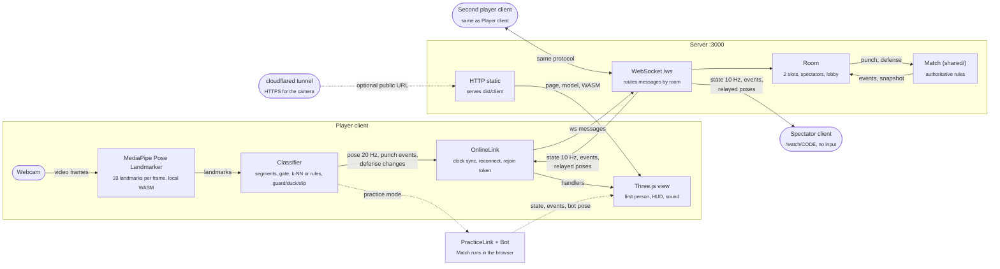
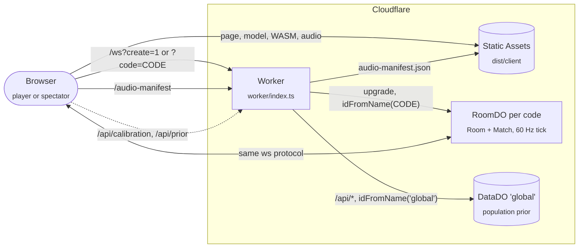
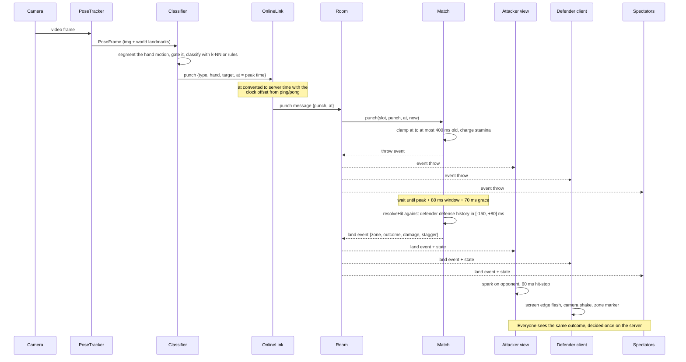
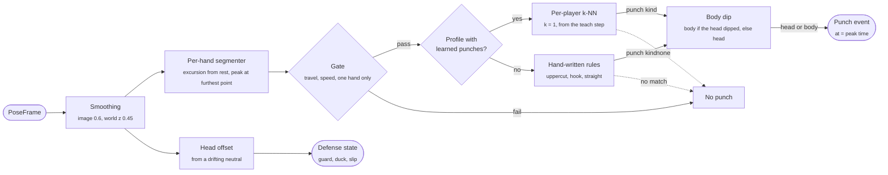

# Keyboard Warrior

A browser boxing game you play with your body. A webcam and MediaPipe pose tracking turn your punches, guard, ducks and slips into moves in a Three.js arena, for 1v1 matches over WebSocket with spectators, or practice against a bot.

## Features

- Webcam control with MediaPipe Pose Landmarker running locally in the browser (model and WASM served by the game, no CDN).
- Six punches (jab, cross, left/right hook, left/right uppercut). A punch thrown standing is a head shot; crouch (dip your head like a duck) as you punch for a body shot.
- Four defenses: high guard, duck, slip left, slip right.
- Stamina, knockdowns with a 10 count, get-ups by holding your guard, KO, TKO and decisions.
- Online 1v1 rooms with 4-letter codes, an authoritative server, clock-synced punch timing and rejoin after a disconnect.
- Spectator view with an orbiting camera at `/watch/CODE`.
- Practice mode against a bot that runs the same match rules in the browser.
- Keyboard mode (`?keys=1`) for playing and testing without a camera.
- Synthesized sound effects and crowd, browser speech for the announcer, with optional mp3 overrides.

## How to play

### Setup

1. Put the laptop at chest height and stand 1.5 to 2 m away.
2. Use good light in front of you, not behind you.
3. Keep your head, shoulders, elbows and hands in frame. The lobby tells you to move closer, step back or raise the camera.

### Calibration

1. Pick Orthodox or Southpaw first. Teaching uses your stance to know which hand throws the jab.
2. Hold your guard (both gloves up by your face) steady for 2 seconds. The game measures your shoulder width, arm length, hand size and guard position and scales every threshold to your body.
3. Teach your punches, about two and a half minutes. An overlay on the webcam walks through:
   - **Rest**, 6 s each: guard up and moving without punching, then dropping your hands and bringing them back. These motions are learned as non-punches.
   - **Duck, slip left, slip right**, 3.5 s each. The duck comes first so your crouch depth is known before the punches.
   - **8 punches** in turn: jab, cross, left hook, right hook, left uppercut, right uppercut, aimed at the face standing tall (head shots), then crouch and jab, crouch and cross (dip your head like a duck, then punch: body shots). Throw each one 5 times, back to guard after each (a step moves on after 5 reps or 15 s). Wind-ups and fidgets around each rep are learned as non-punches, and a rep far from the rest of its move is dropped. The crouch reps set how far your head has to dip for a body shot (see Moves).
   - **Check**: random punches from the list are prompted and read back live with your new model. A wrong or missed read is taught on the spot with the right label (a punch read as no punch also drops the two non-punch examples nearest to it that outvoted it, such as an uppercut wind-up that looks like a body jab), and the move comes back until it is read right twice (at most 4 tries). The right punch at the wrong target is called out ("Read as body. Stand tall for a head shot" or "Read as head. Crouch lower for a body shot") and counted per move. The overlay ends with how often each move was read right; the lobby lists any move that stayed unreliable.

   Punches do not reach the match during this step.
4. Press Ready.

The result is a personal profile, saved in the browser (`localStorage` key `shadowbox:profile:v6`) and reused the next time you calibrate, so teaching only runs once. The lobby shows whether you are using your own model or the default rules. **Teach my punches** runs the teaching step again, and **Skip, use defaults** (shown while teaching) deletes the saved profile and switches to the hand-written rules. Use Recalibrate if tracking feels off; it redoes the guard hold and keeps your profile.

### Moves

| Move | How |
| --- | --- |
| Jab | Punch straight at the camera with your lead hand (left for orthodox, right for southpaw). |
| Cross | Punch straight at the camera with your rear hand. |
| Left / right hook | Elbow bent, hand around shoulder height, swing across. |
| Left / right uppercut | Start below your chin and drive the fist up. |
| Head or body | Head by default. Crouch as you punch (dip your head like a duck) for a body shot; this works for every punch, hooks and uppercuts too. A punch is a body shot when your head dipped at least your body dip below its neutral position, in shoulder widths (sw), between the start of the motion and just past its peak. The default is 0.4 sw; teaching sets it 45% of the way from how far your head moves on standing punches to how deep you crouched on the crouch reps (or your duck, with fewer than two crouch reps), kept between 0.3 and 0.8 sw. The head drop reads the same from any camera height, unlike the fist height. A crouched punch may also count as a duck while you are down. |
| High guard | Both gloves up by your face. |
| Duck | Drop your head well down. |
| Slip left / right | Move your head to the side. |

A punch fires once, as soon as the hand turns back from its furthest point (one frame after the peak, not at the end of the retraction). That hand is locked until it comes back toward where it started (or settles somewhere new) and a short cooldown passes (250 ms, 450 ms when gassed).

### Rules

All numbers come from `shared/rules.ts`.

- **Format:** 3 rounds of 60 s, 8 s breaks, 3 s countdown. Each fighter has 100 HP. The round clock stops while someone is down.
- **Damage:** jab 4, cross 7, hook 9, uppercut 11. Head shots deal x1.5.
- **Guard** blocks any punch but still takes 15% of its damage off HP, and each block costs the defender 4 stamina plus 0.8 per point of the punch's damage. Stamina recovers more slowly while you hold guard (see Stamina).
- **Duck** dodges head shots.
- **Slip** dodges straights (jab and cross) when you slip away from the side the punch lands on. An attacker's right hand lands on your left, so slip right to dodge it, and vice versa.
- **Stagger:** a clean head shot other than a jab that deals 12 or more staggers the defender.
- **Stamina:** 100 max. Punches cost jab 6, cross 10, hook 12, uppercut 14. Recovery starts 600 ms after your last punch at 15 per second, or 10 per second while you hold guard. (A camera player's hands rest at guard between punches; guard used to drain stamina instead, which left camera players exhausted for good.) Below 30 you are gassed: your punches deal x0.6 and your cooldown is longer. At 0 you are exhausted and cannot punch until you recover to 20.
- **Knockdown:** at 0 HP you go down and the referee counts one per second. Hold a steady guard to get up: 2 s after the first knockdown, 3.5 s after later ones. You come back with 30 HP (20 HP after the second knockdown) and 50 stamina, and are protected for 1.5 s after the 1.2 s get-up.
- **KO:** still down at the 10 count.
- **TKO:** the third knockdown ends the fight.
- **Decision:** after 3 rounds, more HP wins, then fewer knockdowns, otherwise a draw.
- **Forfeit:** a player who disconnects mid-match has 60 s to rejoin before losing.

## Architecture

The server owns the match. Clients track the pose, classify moves locally, and send only small messages: a downsampled pose for rendering, punch events with a server-time peak timestamp, and defense changes. The server resolves every punch against the defender's defense history and broadcasts events and state to both players and all spectators. Practice mode and the title screen demo run the same `Match` class from `shared/` in the browser.



The same `Room` and `Match` code also runs serverless on Cloudflare (`worker/index.ts`, `wrangler.jsonc`). Workers Static Assets serves `dist/client`, and each room is one SQLite-backed Durable Object named by its code. The client connects to `/ws?create=1` or `/ws?code=CODE` so the Worker can route the socket before the first message; the Node server ignores the query and routes by that first create/join/watch message, as before. Both runtimes share the per-socket logic in `server/session.ts`.



One punch, from camera frame to both screens:



Hit resolution order (`shared/match.ts` and `shared/hit.ts`), first match wins:

1. **Immune:** the defender is down, getting up or still protected after a get-up (or the attacker is no longer up). The punch whiffs.
2. **Duck:** a head shot while the defender ducked at any moment in the window is dodged.
3. **Slip:** a jab or cross while the defender slipped away from the landing side is dodged.
4. **Guard:** a held guard blocks with 15% chip damage and costs the defender 4 stamina plus 0.8 per point of damage.
5. **Clean hit:** full damage, x0.6 if the attacker was gassed when throwing. A head cross, hook or uppercut dealing 12 or more also staggers.

The defense window is 150 ms before to 80 ms after the punch peak. Any defense held at any moment in that window counts.

Hard limits:

- Poses are sent at most 20 times per second; full state is broadcast every 100 ms (10 Hz) and immediately after any match event.
- Punch timestamps older than 400 ms on arrival are clamped to 400 ms, and timestamps in the future are clamped to now.
- WebSocket messages are capped at 64 KB (`maxPayload`). Pose messages must carry exactly 13 landmarks (39 numbers).
- A disconnect mid-match pauses it; the player has 60 s to rejoin with the token stored in `localStorage`, then forfeits.
- Rooms with nobody connected are dropped after 10 minutes without activity. On Cloudflare a room lives only in its Durable Object's memory, which stops ticking when the last socket closes and can be evicted soon after.
- On Cloudflare, `/ws?create=1` picks a random code in the Worker and retries up to 8 times if that room is in use.

### Move classification

`client/src/tracking/classifier.ts` turns each tracked frame into punch events and a defense state. Thresholds live in `client/src/config.ts`; distances are in calibrated shoulder widths (sw).



Punch pipeline, per hand:

0. **Frames:** `PoseTracker` (`client/src/tracking/pose.ts`) runs one detection per new camera frame (`requestVideoFrameCallback`, or `requestAnimationFrame` with a `currentTime` check), GPU first with a CPU fallback. Each frame is stamped with the camera's capture time (falling back to its presentation time), so velocities follow the real frame spacing.
1. **Track:** each hand is followed on screen in its own frame: origin between the shoulders, x toward the body midline (mirrored for the left hand so both hands share one frame), y up, in sw. While the hand is slower than 1.5 sw/s its rest position follows it.
2. **Segment:** a motion starts once the hand moves away from rest past 0.3 sw, measured from the last frame it was near rest. The peak is the furthest point from rest. Once the hand turns back (one frame past the furthest point and heading home, or nearly stopped), the motion so far is read right away and fires if it is a punch. Otherwise it is followed on and read again when it ends: back to 80% of that distance, stalled for two frames, or after 550 ms. Afterwards the hand is free again once it is back home along the line it went out on (a fast swing through rest counts) or has settled for 350 ms, so a retraction never becomes a motion of its own.
3. **Gate:** the motion must travel at least 0.55 sw and reach 4 sw/s (speeds measured over frame gaps longer than 50 ms are scaled up, by at most 1/0.75, since they average over more of the punch). A mostly vertical motion while the other hand moves the same way by at least 60% as much (raising or dropping the guard) is not a punch. This applies whichever classifier is active.
4. **Decide:** with a saved profile, a k-NN (`client/src/tracking/model.ts`) compares a 17-number on-screen shape of the motion (displacement, where the fist ends relative to the nose, forearm direction and elbow travel, hand growth, path bend, wind-up, duration, the other hand's motion, start position, head drop) against the player's own taught samples of the same hand. Features are standardized with a floor so near-constant ones cannot dominate. World depth and the 3D elbow angle are left out: MediaPipe gets them wrong too often on fast punches. Labels are `straight`, `hook`, `uppercut` or `none`; hand and stance give the exact punch, and the head dip against the player's body dip gives the target (see Moves). When the population prior is available its samples join the player's own at 1.3 times their distance. Without a profile the hand-written rules decide, with the default body dip of 0.4 sw.
5. **Fire:** the punch is sent with the peak time, on the frame after the peak in most cases.

Defense, every frame:

- **Neutral:** the head offset is measured from a neutral nose position that starts at the calibrated one and follows slow drift (3 s time constant) while the head is within half a duck or slip threshold, so stepping around does not read as a slip.
- **Duck and slip** fire when the offset passes 0.55 sw down or 0.5 sw sideways. The teach step personalizes each to half of the deepest duck or slip you showed, if it reached at least 60% of the default, and never below half the default. Slips are ignored during a hand motion and for 300 ms after, since punching moves the head. Ducks are not, and never block a punch: a crouched body shot fires as a punch and can read as a duck at the same time.
- **Guard** needs both hands out of a motion, slow and up by the face. The height and head-distance limits are the defaults or, if looser, your calibrated guard position plus 0.3 sw, with 0.2 sw of hysteresis once held.

Accuracy is measured against hand-checked rep times (`scripts/eval-gt.ts`) on the 12 recorded clips in `tests/fixtures/` (one orthodox player, 39 reps) and on a real teach session (22 reps), replaying the live classifier frame by frame (`scripts/eval-calibration.ts`). Trained on 4 of 5 reps per move, 87% of fixture punches come out exactly right (type and head/body) with 1 extra fire, and the 4 defense clips fire nothing; trained on the first 3 reps, 73%. On the teach session, where most moves only got two real reps and the camera sat high, 77% of types are right. Every recorded rep was thrown standing (including the ones aimed low before the crouch rule), so each is scored as a head shot. Head or body alone (`scripts/eval-target.ts`, `tests/target.test.ts`): all 35 fixture reps and all 21 teach-session reps read as head, with the default body dip and with the 0.55 sw the duck clip would set (the deepest head dip on any of them is 0.28 sw, a low jab). The recorded duck clip fires at most one punch. There is no recorded crouch-punch data yet; body shots are tested with synthetic poses that crouch through the punch. Punches fire a median 60 ms (p90 124 ms) after the hand-checked peak on the fixtures and 48 ms (p90 113 ms) on the teach session, recorded at about 25 fps. The segmenter finds 35 of 39 fixture reps at full frame rate, 35 at half and 34 at a third (`scripts/eval-speed.ts`); trained at full rate, 30 of 35 and 28 of 34 of those are read right. Ducks are detected 5 of 5 with no ducks in the punch clips; slips 4 of 5 left and 3 of 5 right.

## Getting Started

Requires Node.js 24. `npm run tunnel` also needs [cloudflared](https://developers.cloudflare.com/cloudflare-one/connections/connect-networks/downloads/) on your PATH.

```sh
npm install
npm run dev
```

`npm run dev` copies the MediaPipe WASM into `client/public/mediapipe/wasm`, starts the game server on :3000 (with `tsx watch`) and opens Vite on http://localhost:5173, which proxies `/ws` to the server. Camera access works on `localhost` without HTTPS.

Production build, everything served by the Node server on :3000:

```sh
npm run build && npm start
```

To play with someone on another machine, run the production build and then:

```sh
npm run tunnel
```

This starts a cloudflared quick tunnel to http://localhost:3000 and prints a public HTTPS URL. Browsers only allow the camera over HTTPS (or on localhost), so share that URL rather than a LAN address.

### Deploy (serverless, free)

The game can run on Cloudflare's free Workers plan with no server of your own. Log in once, then deploy:

```sh
npx wrangler login
npm run deploy
```

`npm run deploy` builds the client, writes `dist/client/audio-manifest.json` and runs `wrangler deploy`, which prints a `https://keyboard-warrior.<your-subdomain>.workers.dev` URL. `npm run cf:dev` runs the same Worker and Durable Objects locally on http://localhost:8787 without a login.


Free plan limits, reset daily at 00:00 UTC: 100,000 Worker requests and 100,000 Durable Object requests (each socket connect is one; incoming WebSocket messages count 20 to 1), and 13,000 GB-s of Durable Object duration, which is about 29 hours of open rooms. Static asset requests are free. Over a limit, new requests fail until the reset. The Node server with `npm run tunnel` remains an option.

Checks:

```sh
npm test          # Vitest: classifier, teach step, recorded fixtures, hit resolution, match rules, rooms
npm run typecheck # tsc for the client, server and shared code, then for worker/ with Workers types
```

### Tuning

These scripts replay the recorded clips in `tests/fixtures/` through the classifier. Recording clips is covered in [FIXTURES.md](FIXTURES.md).

```sh
npx tsx scripts/eval-calibration.ts        # end to end: replayed calibrations scored against hand-checked reps
npx tsx scripts/eval-model.ts --verbose    # k-NN leave-one-out per motion, fixtures and teach session
npx tsx scripts/eval-target.ts             # head or body per rep, the live rule against the alternatives
npx tsx scripts/eval-speed.ts              # reps caught and read with frames dropped
npx tsx scripts/eval-session.ts            # train on a teach session, replay a play session
npx tsx scripts/eval-defense.ts            # guard, duck and slip onsets per clip
npx tsx scripts/dump-segments.ts jab-head  # every motion segment's features in matching clips
npx tsx scripts/analyze-fixtures.ts jab    # every rule decision and defense change, --trace for per-frame features
```

### URLs

| Path | Page |
| --- | --- |
| `/` | Title screen with a bot vs bot demo behind the menu |
| `/practice` | Practice against the bot |
| `/create` | Create a room, then share the opponent and watch links |
| `/join/CODE` | Invite link for the opponent; joins room `CODE` as a player (opens the spectator view if full) |
| `/play/CODE` | Your own seat in room `CODE`; reloading it rejoins the same corner |
| `/watch/CODE` | Watch room `CODE` |

### Flags

| Flag | Effect |
| --- | --- |
| `?keys=1` | Keyboard mode, no camera. Keys below. |
| `?debug=1` | Shows classifier features, defense state and match numbers, plus the tracker's delegate, pose model, frame rate and detection time. In a fight it also shows the last punch decision (and whether it was blocked because you could not punch), the last punch sent, whether the match took it, and how it landed. |
| `?model=lite` / `?model=full` | Pins the pose model. By default tracking starts on full and drops to lite if it stays under 28 fps for 2 s because detection is the bottleneck (camera frames skipped or detection slower than 28 fps). |
| `?record=1` | Shows a guided recorder that saves labelled clips of every move into `tests/fixtures/`. See [FIXTURES.md](FIXTURES.md). |

Keyboard mode keys:

| Key | Action |
| --- | --- |
| J | Jab |
| K | Cross |
| U / I | Left / right hook |
| N / M | Left / right uppercut |
| Shift + punch | Body shot, crouched (a plain punch is a head shot) |
| Space (hold) | High guard |
| S (hold) | Duck |
| A / D (hold) | Slip left / right |

## Audio

Every sound is synthesized at runtime with the Web Audio API, and the announcer uses the browser's speech synthesis, so no audio files are required.

To override any sound, drop an mp3 with the matching name into `client/public/audio/`. The game loads it on first interaction and falls back to the synthesizer for anything missing.

Sounds are layered per event in `client/src/ui/announce.ts`:

| Event | Sounds |
|---|---|
| Punch thrown | `swoosh` (quiet, louder for hooks and uppercuts) |
| Hit landed | `hit_light`, `hit_heavy` (9+ damage) or `impact_big` (stagger or 12+), always with a `body_thump`; heavy hits add `cheer` or `ooh`, big hits add `ooh` and duck the crowd |
| Blocked | `block`, sometimes `crowd_murmur` |
| Missed or dodged | `whoosh`; a dodged hook or uppercut sometimes gets an `ooh` |
| Round start | `hype` crowd swell, then `bell`, then the "Fight" call |
| 10 seconds left | `clapper` (from `clockTick()` in `announce.ts`) |
| Round end | `bell_end`, `cheer` |
| Knockdown | `ko_slam`, `roar`, crowd ducked then swelled |
| Referee count | `count_tick` plus a crowd `stomp` that grows with the count; `chant` at 2 and 6 |
| Get up | `cheer` |
| Match end | `bell`; KO or TKO adds `ko_stinger` and `roar`, otherwise `cheer`; a winner gets `fanfare` |

Percussive sounds play with a random +-6% playback rate and slight level jitter so repeats differ. Crowd reactions have cooldowns so they do not stack. The crowd loop (`crowd.mp3`) sits low, swells with `sound.excite(k)` on big moments and ducks under knockdowns, big hits and announcer lines. All effects go through a light bus compressor.

- Effects: `hit_light`, `hit_heavy`, `impact_big`, `body_thump`, `block`, `whoosh`, `swoosh`, `bell`, `bell_end`, `hype`, `clapper`, `roar`, `cheer`, `ooh`, `crowd_murmur`, `chant`, `stomp`, `count_tick`, `ko_slam`, `ko_stinger`, `fanfare` (each as `<name>.mp3`, list in `SFX_NAMES` in `client/src/audio/synth.ts`)
- Crowd loop: `crowd.mp3`
- Announcer: `announcer_<key>.mp3`, where `<key>` is one of `welcome`, `round1`, `round2`, `round3`, `fight`, `time`, `down_red`, `down_blue`, `up`, `big_shot`, `uppercut`, `ko`, `tko`, `decision`, `draw`, `forfeit`, `red_wins`, `blue_wins` (lines in `ANNOUNCER_LINES` in `client/src/audio/sound.ts`).

Optionally, `npm run gen:audio` generates all of these with the ElevenLabs API. Put `ELEVENLABS_API_KEY=...` in `.env` at the repo root (see `.env.example`); `ELEVENLABS_VOICE_ID` picks the announcer voice. Existing files are skipped unless you pass `--force`, and `--only=bell,announcer_ko` limits the run. With `ffmpeg` on PATH, effects are trimmed of leading silence and peak-normalized to -1 dBFS after download (`--polish` reruns that on existing files); `FILE_GAIN` in `sound.ts` sets the mix. This is never needed to play.

## Project layout

```
client/
  index.html
  public/
    audio/            optional mp3 overrides
    models/           pose_landmarker_full.task, pose_landmarker_lite.task (downloaded by scripts/copy-assets.mjs if missing)
    mediapipe/wasm/   copied from node_modules by scripts/copy-assets.mjs
  src/
    main.ts           routing: title, practice, create, play, watch
    config.ts         classifier, gate, model, defense, calibration and framing settings
    audio/            sound manager and synthesizer
    net/              MatchLink interface and the WebSocket OnlineLink
    practice/         Bot, PracticeLink and the title screen DemoLink
    scene/            Three.js stage, arena, avatars, first-person gloves
    tracking/         PoseTracker, calibration, classifier, k-NN model, teach step, data sharing, keyboard input, synthetic poses
    ui/               HUD, announcer events, webcam preview, fixture recorder, DOM helpers
    views/            player (first person) and spectator views
server/
  index.ts            HTTP static server, WebSocket /ws, room registry
  room.ts             one room: players, spectators, authoritative Match
  session.ts          per-socket message handling shared with the Worker
  data-store.ts       /api calibration upload, prior and export, shared with the Worker
worker/
  index.ts            Cloudflare Worker, the RoomDO and DataDO Durable Objects
wrangler.jsonc        Cloudflare config: assets, Durable Object bindings, migrations
shared/
  types.ts            wire protocol and shared types
  calibration-data.ts upload validation and population prior computation
  rules.ts            every game number
  match.ts            match simulation used by server and practice mode
  hit.ts              hit resolution against defense history
scripts/
  copy-assets.mjs     copies MediaPipe WASM into client/public
  audio-manifest.mjs  writes dist/client/audio-manifest.json at build time
  gen-audio.ts        optional ElevenLabs audio generation
  eval-*.ts           classifier evaluation on recorded fixtures (eval-core.ts is shared with the tests)
  dump-segments.ts    prints motion segment features
  analyze-fixtures.ts prints classifier decisions per clip
tests/                Vitest suites, plus recorded fixtures in tests/fixtures/
vite.config.ts        Vite config, with a dev-only endpoint that saves recorder clips
```

## License

MIT, teddycitrus.
