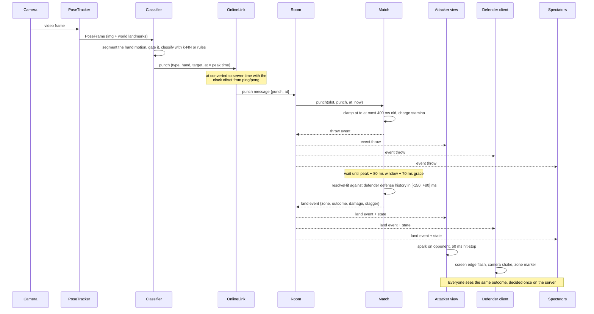
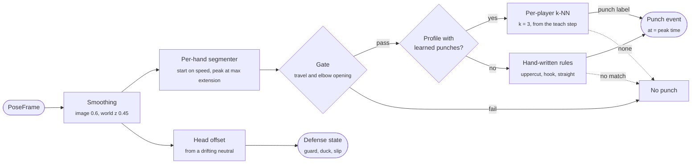

# Shadow Box

A browser boxing game you play with your body. A webcam and MediaPipe pose tracking turn your punches, guard, ducks and slips into moves in a Three.js arena, for 1v1 matches over WebSocket with spectators, or practice against a bot.

## Features

- Webcam control with MediaPipe Pose Landmarker running locally in the browser (model and WASM served by the game, no CDN).
- Six punches (jab, cross, left/right hook, left/right uppercut), each to the head or body.
- Four defenses: high guard, duck, slip left, slip right.
- Stamina, knockdowns with a 10 count, get-ups by holding your guard, KO, TKO and decisions.
- Online 1v1 rooms with 4-letter codes, an authoritative server, clock-synced punch timing and rejoin after a disconnect.
- Spectator view with an orbiting camera at `/watch/CODE`.
- Practice mode against a bot that runs the same match rules in the browser.
- Keyboard mode (`?keys=1`) for playing and testing without a camera.
- Synthesized sound effects and crowd, browser speech for the announcer, with optional mp3 overrides.

## How to play

### Setup

1. Put the laptop at chest height and stand 1.5 to 2 m away.
2. Use good light in front of you, not behind you.
3. Keep your head, shoulders, elbows and hands in frame. The lobby tells you to move closer, step back or raise the camera.

### Calibration

1. Pick Orthodox or Southpaw first. Teaching uses your stance to know which hand throws the jab.
2. Hold your guard (both gloves up by your face) steady for 2 seconds. The game measures your shoulder width, arm length, hand size and guard position and scales every threshold to your body.
3. Teach your punches, about 60 s. An overlay on the webcam prompts 8 punches in turn: jab, cross, left hook, right hook, left uppercut, right uppercut, jab to the body, cross to the body. Throw each one 3 times, back to guard after each (a step moves on after 3 reps or 9 s). Then duck, slip left and slip right, 3.5 s each. Punches do not count during this step.
4. Press Ready.

The result is a personal profile, saved in the browser (`localStorage` key `shadowbox:profile:v2`) and reused the next time you calibrate, so teaching only runs once. The lobby shows whether you are using your own model or the default rules. **Teach my punches** runs the teaching step again, and **Skip, use defaults** (shown while teaching) deletes the saved profile and switches to the hand-written rules. Use Recalibrate if tracking feels off; it redoes the guard hold and keeps your profile.

### Moves

| Move | How |
| --- | --- |
| Jab | Punch straight at the camera with your lead hand (left for orthodox, right for southpaw). |
| Cross | Punch straight at the camera with your rear hand. |
| Left / right hook | Elbow bent, hand around shoulder height, swing across. |
| Left / right uppercut | Start below your chin and drive the fist up. |
| Head or body | With a taught profile, learned from your head and body jab and cross reps (hooks and uppercuts are taught to the head). With the default rules, decided by wrist height at the peak of the punch: above a line just under your shoulders is a head shot, below it is a body shot. |
| High guard | Both gloves up by your face. |
| Duck | Drop your head well down. |
| Slip left / right | Move your head to the side. |

A punch fires once, at peak extension. That hand is locked until it returns to guard and a short cooldown passes (250 ms, 450 ms when gassed).

### Rules

All numbers come from `shared/rules.ts`.

- **Format:** 3 rounds of 60 s, 8 s breaks, 3 s countdown. Each fighter has 100 HP. The round clock stops while someone is down.
- **Damage:** jab 4, cross 7, hook 9, uppercut 11. Head shots deal x1.5.
- **Guard** blocks any punch but still takes 10% chip damage, and each block costs the defender 4 stamina.
- **Duck** dodges head shots.
- **Slip** dodges straights (jab and cross) when you slip away from the side the punch lands on. An attacker's right hand lands on your left, so slip right to dodge it, and vice versa.
- **Stagger:** a clean head shot other than a jab that deals 12 or more staggers the defender.
- **Stamina:** 100 max. Punches cost jab 6, cross 10, hook 12, uppercut 14. Recovery starts 600 ms after your last punch at 15 per second, or 25 per second while holding guard. Below 30 you are gassed: your punches deal x0.6 and your cooldown is longer. At 0 you are exhausted and cannot punch until you recover to 20.
- **Knockdown:** at 0 HP you go down and the referee counts one per second. Hold a steady guard to get up: 2 s after the first knockdown, 3.5 s after later ones. You come back with 30 HP (20 HP after the second knockdown) and 50 stamina, and are protected for 1.5 s after the 1.2 s get-up.
- **KO:** still down at the 10 count.
- **TKO:** the third knockdown ends the fight.
- **Decision:** after 3 rounds, more HP wins, then fewer knockdowns, otherwise a draw.
- **Forfeit:** a player who disconnects mid-match has 60 s to rejoin before losing.

## Architecture

The server owns the match. Clients track the pose, classify moves locally, and send only small messages: a downsampled pose for rendering, punch events with a server-time peak timestamp, and defense changes. The server resolves every punch against the defender's defense history and broadcasts events and state to both players and all spectators. Practice mode and the title screen demo run the same `Match` class from `shared/` in the browser.


One punch, from camera frame to both screens:



Hit resolution order (`shared/match.ts` and `shared/hit.ts`), first match wins:

1. **Immune:** the defender is down, getting up or still protected after a get-up (or the attacker is no longer up). The punch whiffs.
2. **Duck:** a head shot while the defender ducked at any moment in the window is dodged.
3. **Slip:** a jab or cross while the defender slipped away from the landing side is dodged.
4. **Guard:** a held guard blocks with 10% chip damage and costs the defender 4 stamina.
5. **Clean hit:** full damage, x0.6 if the attacker was gassed when throwing. A head cross, hook or uppercut dealing 12 or more also staggers.

The defense window is 150 ms before to 80 ms after the punch peak. Any defense held at any moment in that window counts.

Hard limits:

- Poses are sent at most 20 times per second; full state is broadcast every 100 ms (10 Hz) and immediately after any match event.
- Punch timestamps older than 400 ms on arrival are clamped to 400 ms, and timestamps in the future are clamped to now.
- WebSocket messages are capped at 64 KB (`maxPayload`). Pose messages must carry exactly 13 landmarks (39 numbers).
- A disconnect mid-match pauses it; the player has 60 s to rejoin with the token stored in `localStorage`, then forfeits.
- Rooms with nobody connected are dropped after 10 minutes without activity.

### Move classification

`client/src/tracking/classifier.ts` turns each tracked frame into punch events and a defense state. Thresholds live in `client/src/config.ts`; distances are in calibrated shoulder widths (sw).



Punch pipeline, per hand:

1. **Segment:** a motion starts when hand speed reaches 3.0 sw/s. The peak is the frame with the highest extension score (3D reach, depth toward the camera, on-screen hand growth and distance travelled). The motion ends when speed drops below 35% of its maximum, or after 450 ms.
2. **Gate:** the motion must travel at least 0.45 sw and the elbow must open by at least 15 degrees. Anything else is not a punch, whichever classifier is active.
3. **Decide:** with a saved profile, a k-NN (`client/src/tracking/model.ts`) compares a 16-number feature vector of the motion (sideways sweep, rise, depth, elbow angles, wrist height, distance to the head, travel, speed, duration) against the player's own taught samples of the same hand, standardized and with distance-weighted votes. Labels are `type:target` or `none`, so the teach step also learns which motions are not punches (returning to guard, adjusting). Without a profile the hand-written rules decide.
4. **Fire:** the punch is sent with the peak time. The hand stays locked until it is back near the face and the cooldown has passed.

Defense, every frame:

- **Neutral:** the head offset is measured from a neutral nose position that starts at the calibrated one and follows slow drift (3 s time constant) while the head is within half a duck or slip threshold, so stepping around does not read as a slip.
- **Duck and slip** fire when the offset passes 0.55 sw down or 0.5 sw sideways. The teach step personalizes each to half of the deepest duck or slip you showed, if it reached at least 60% of the default, and never below half the default. Slips are ignored during a hand motion and for 300 ms after, since punching moves the head.
- **Guard** needs both hands out of a motion, slow and up by the face. The height and head-distance limits are the defaults or, if looser, your calibrated guard position plus 0.3 sw, with 0.2 sw of hysteresis once held.

On the 12 recorded clips in `tests/fixtures/` (one orthodox player), the hand-written rules get 19% of gated punches exactly right. The per-player k-NN gets 81% in leave-one-out, and 82% exact with 1 false fire in 13 non-punch motions when trained, as in the teach step, on the first 3 reps of each clip. Ducks are detected 5 of 5 with no ducks in the punch clips; slips 4 of 5 left and 3 of 5 right.

## Getting Started

Requires Node.js 24. `npm run tunnel` also needs [cloudflared](https://developers.cloudflare.com/cloudflare-one/connections/connect-networks/downloads/) on your PATH.

```sh
npm install
npm run dev
```

`npm run dev` copies the MediaPipe WASM into `client/public/mediapipe/wasm`, starts the game server on :3000 (with `tsx watch`) and opens Vite on http://localhost:5173, which proxies `/ws` to the server. Camera access works on `localhost` without HTTPS.

Production build, everything served by the Node server on :3000:

```sh
npm run build && npm start
```

To play with someone on another machine, run the production build and then:

```sh
npm run tunnel
```

This starts a cloudflared quick tunnel to http://localhost:3000 and prints a public HTTPS URL. Browsers only allow the camera over HTTPS (or on localhost), so share that URL rather than a LAN address.

Checks:

```sh
npm test          # Vitest: classifier, teach step, recorded fixtures, hit resolution, match rules, rooms
npm run typecheck # tsc --noEmit
```

### Tuning

These scripts replay the recorded clips in `tests/fixtures/` through the classifier. Recording clips is covered in [FIXTURES.md](FIXTURES.md).

```sh
npx tsx scripts/eval-model.ts --verbose    # rules vs k-NN: leave-one-out and simulated 2/3-rep calibrations
npx tsx scripts/eval-defense.ts            # guard, duck and slip onsets per clip
npx tsx scripts/dump-segments.ts jab-head  # every motion segment's features in matching clips
npx tsx scripts/analyze-fixtures.ts jab    # every rule decision and defense change, --trace for per-frame features
```

### URLs

| Path | Page |
| --- | --- |
| `/` | Title screen with a bot vs bot demo behind the menu |
| `/practice` | Practice against the bot |
| `/create` | Create a room, then share the opponent and watch links |
| `/play/CODE` | Join room `CODE` as a player (opens the spectator view if full) |
| `/watch/CODE` | Watch room `CODE` |

### Flags

| Flag | Effect |
| --- | --- |
| `?keys=1` | Keyboard mode, no camera. Keys below. |
| `?debug=1` | Shows classifier features, defense state and match numbers. |
| `?record=1` | Shows a guided recorder that saves labelled clips of every move into `tests/fixtures/`. See [FIXTURES.md](FIXTURES.md). |

Keyboard mode keys:

| Key | Action |
| --- | --- |
| J | Jab |
| K | Cross |
| U / I | Left / right hook |
| N / M | Left / right uppercut |
| Shift + punch | Body shot |
| Space (hold) | High guard |
| S (hold) | Duck |
| A / D (hold) | Slip left / right |

## Audio

Every sound is synthesized at runtime with the Web Audio API, and the announcer uses the browser's speech synthesis, so no audio files are required.

To override any sound, drop an mp3 with the matching name into `client/public/audio/`. The game loads it on first interaction and falls back to the synthesizer for anything missing.

- Effects: `hit_light.mp3`, `hit_heavy.mp3`, `block.mp3`, `whoosh.mp3`, `bell.mp3`, `roar.mp3`
- Crowd loop: `crowd.mp3`
- Announcer: `announcer_<key>.mp3`, where `<key>` is one of `welcome`, `round1`, `round2`, `round3`, `fight`, `time`, `down_red`, `down_blue`, `up`, `big_shot`, `uppercut`, `ko`, `tko`, `decision`, `draw`, `forfeit`, `red_wins`, `blue_wins` (lines in `ANNOUNCER_LINES` in `client/src/audio/sound.ts`).

Optionally, `npm run gen:audio` generates all of these with the ElevenLabs API. Put `ELEVENLABS_API_KEY=...` in `.env` at the repo root (see `.env.example`); `ELEVENLABS_VOICE_ID` picks the announcer voice. Existing files are skipped unless you pass `--force`, and `--only=bell,announcer_ko` limits the run. This is never needed to play.

## Project layout

```
client/
  index.html
  public/
    audio/            optional mp3 overrides
    models/           pose_landmarker_full.task
    mediapipe/wasm/   copied from node_modules by scripts/copy-assets.mjs
  src/
    main.ts           routing: title, practice, create, play, watch
    config.ts         classifier, gate, model, defense, calibration and framing settings
    audio/            sound manager and synthesizer
    net/              MatchLink interface and the WebSocket OnlineLink
    practice/         Bot, PracticeLink and the title screen DemoLink
    scene/            Three.js stage, arena, avatars, first-person gloves
    tracking/         PoseTracker, calibration, classifier, k-NN model, teach step, keyboard input, synthetic poses
    ui/               HUD, announcer events, webcam preview, fixture recorder, DOM helpers
    views/            player (first person) and spectator views
server/
  index.ts            HTTP static server, WebSocket /ws, room registry
  room.ts             one room: players, spectators, authoritative Match
shared/
  types.ts            wire protocol and shared types
  rules.ts            every game number
  match.ts            match simulation used by server and practice mode
  hit.ts              hit resolution against defense history
scripts/
  copy-assets.mjs     copies MediaPipe WASM into client/public
  gen-audio.ts        optional ElevenLabs audio generation
  eval-*.ts           classifier evaluation on recorded fixtures (eval-core.ts is shared with the tests)
  dump-segments.ts    prints motion segment features
  analyze-fixtures.ts prints classifier decisions per clip
tests/                Vitest suites, plus recorded fixtures in tests/fixtures/
vite.config.ts        Vite config, with a dev-only endpoint that saves recorder clips
```

## License

MIT, teddycitrus.
